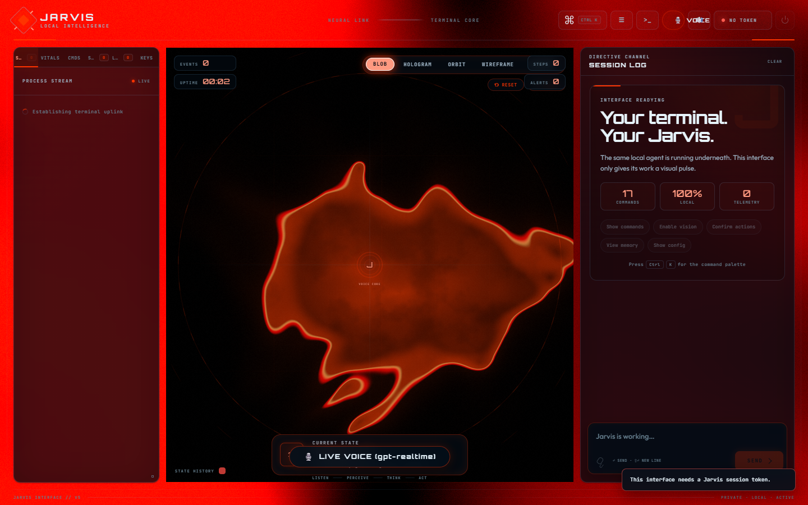

<div align="center">

# ⚡ J.A.R.V.I.S.
### Next-Generation Autonomous AI Desktop Operating Assistant

[](https://www.python.org/)
[](https://github.com/Satvik374/Jarvis)
[](LICENSE)
[](https://openrouter.ai/)
[](#-the-action-space)
[](tests)

<br/>



<p align="center">
  <b>Jarvis</b> is an autonomous, full-duplex agentic assistant that perceives your screen, reasons in real time, and operates your desktop directly — moving the mouse, clicking exact UI elements, typing, running commands, and managing complex multi-step workflows.
</p>

[✨ Features](#-key-features) • [🚀 Quick Start](#-quick-start) • [⌨️ CLI Reference](#-cli-reference) • [💬 Console Commands](#-interactive-console-commands) • [🧠 Architecture](#-grounded-vision--system-architecture) • [🧪 Testing](#-testing) • [🩺 Troubleshooting](#-troubleshooting)

</div>

---

## 📑 Table of Contents

- [Demonstration](#-demonstration)
- [Key Features](#-key-features)
- [Grounded Vision & System Architecture](#-grounded-vision--system-architecture)
- [Requirements](#-requirements)
- [Quick Start](#-quick-start)
- [CLI Reference](#-cli-reference)
- [Interactive Console Commands](#-interactive-console-commands)
- [Brain Backends](#-brain-backends)
- [Voice & Real-Time Conversational AI](#-voice--real-time-conversational-ai)
- [The Action Space](#-the-action-space)
- [Remote & Android Device Orchestration](#-remote--android-device-orchestration)
- [Connectors & Integrations](#-connectors--integrations)
- [Project Organization](#-project-organization)
- [Configuration](#-configuration)
- [Testing](#-testing)
- [Troubleshooting](#-troubleshooting)
- [Documentation Index](#-documentation-index)
- [Security & Privacy](#-security--privacy)
- [Contributing](#-contributing)
- [License](#-license)

---

## 🎥 Demonstration

| Holographic Dashboard | Mobile Control |
|:---:|:---:|
|  |  |
| *Liquid Energy Blob, audio spectrum and live agent transcript* | *Paired Android device with element-level control* |

> 🎬 **Video demos:** the promo composition lives in [`videos/jarvis-promo`](videos/jarvis-promo) (`demo.mp4`), with the storyboard and brief alongside it. Hero banners are in [`assets/banners/jarvis-hero`](assets/banners/jarvis-hero).

---

## ✨ Key Features

- 👁️ **Grounded UI Perception (Set-of-Marks):** native Windows UI Automation (UIA) maps every button, input and menu to a precise element ID instead of a guessed coordinate, with OCR as a fallback for icon buttons, canvases and games.
- 🎙️ **Zero-Latency Conversational Voice:** real-time full-duplex speech over **Gemini Live**, hosted **Fish Audio Agents**, or fully offline **Kokoro-82M ONNX** neural TTS.
- 🔮 **Cyber Holographic Dashboard:** a fluid WebGL core (`Liquid Energy Blob`, `Hologram`, `Quantum Orbit` modes) that reacts to Jarvis's state, actions and speech amplitude.
- ⚡ **Local & Cloud Intelligence:** 12 selectable backends — local **Ollama**, **LM Studio**, **llama.cpp**, **vLLM**, or hosted **OpenRouter**, **OmniRoute**, **OpenAI**, **Anthropic**, **Vertex AI**, **Azure AI Foundry** and **OpenAI Codex**.
- 🧠 **Long-Term Memory:** vector store + knowledge graph RAG, permanent facts, coordinate memory, and an optional **Obsidian vault** that works as both memory source and sink.
- 🛠️ **92 Computer-Control Actions:** pointer, keyboard, apps, files, shells, coding helpers, browser automation, scheduling, diagnostics and a self-healing loop.
- 📱 **Cross-Device Remote & Mobile Agent:** control paired Android devices and remote workstations over an end-to-end encrypted relay (X25519 + Ed25519 + ChaCha20-Poly1305).
- 🗣️ **Offline "Hey Jarvis" Wake Word:** hands-free listening with no idle cloud traffic.
- 🛡️ **Guardrails You Control:** per-action confirmation, command denylisting, a credential vault, and an isolated **Shadow Desktop** for zero-interference automation.

---

## 🧠 Grounded Vision & System Architecture

```
  ┌──────────────┐     ┌──────────────┐     ┌──────────────┐     ┌─────────────────┐
  │  Perception  │ ──▶ │  Cognition   │ ──▶ │    Action    │ ──▶ │ Feedback Loop   │
  │ UI Tree + UIA│     │ Local / LLM  │     │ Mouse / Keys │     │ State Check &   │
  │ Screen Frame │     │  Reasoning   │     │ Shell / Apps │     │ Next Objective  │
  └──────────────┘     └──────────────┘     └──────────────┘     └─────────────────┘
```

Jarvis bypasses hallucinated coordinates by labelling actionable controls before passing them to the reasoning brain:

```text
[0] Button    "Save Document"         @ (512, 40)
[1] TextField "File name:"            @ (300, 80)
[2] MenuItem  "Export as PDF"         @ (20, 30)
```

The model selects targets deterministically (*"click element 0"*), which keeps clicks accurate across native and browser applications. If a control has no accessible name, Windows OCR supplies the label; the `click_target` voice path uses the same fallback.

The loop also self-heals: failed steps are retried with tree-of-thought planning, and `verify_success` checks the result before the agent declares a task complete.

---

## 📋 Requirements

| Component | Requirement |
|---|---|
| **OS** | Windows 10/11 for desktop control (UI Automation, OCR, `sounddevice`). The core agent and test suite are cross-platform. |
| **Python** | 3.10 or newer |
| **RAM / GPU** | 8 GB RAM is enough for cloud backends. A local model wants ~4 GB VRAM (RTX 2050-class) — see [`training/README.md`](training/README.md) for measured numbers. |
| **Optional** | Android SDK 35 only if you want to build the companion APK. |

> **Note:** `uiautomation`, `pywin32`, `colorama` and `sounddevice` install only on Windows (PEP 508 markers in `requirements.txt`). On other platforms Jarvis falls back to coordinate/screenshot operation and the voice engine is unavailable.

---

## 🚀 Quick Start

### 1. Clone (with the relay submodule)

```bash
git clone --recurse-submodules https://github.com/Satvik374/Jarvis.git
cd Jarvis
```

Already cloned without submodules? Fetch the remote relay with:

```bash
git submodule update --init --recursive
```

> `relay_server/` is a git submodule pointing at [`Satvik374/jarvis-server`](https://github.com/Satvik374/jarvis-server). It is empty until initialized — remote pairing and the mobile app need it, everything else runs without it.

### 2. Install dependencies

A virtual environment keeps the app and the training stack apart:

```bash
python -m venv .venv
# Windows
.venv\Scripts\activate
# macOS / Linux
source .venv/bin/activate

pip install -r requirements.txt
```

Training dependencies are separate (`training/requirements-train.txt`, large CUDA stack) — install them only if you plan to fine-tune a model.

### 3. Configure a brain backend

```bash
cp .env.example .env      # then fill in the keys you use
```

`config.yaml` ships with a working default (**OmniRoute** on `http://localhost:20128/v1`). To use a hosted provider instead:

```yaml
# config.yaml
brain:
  backend: openrouter
  model: deepseek/deepseek-v4-flash-0731:free
  use_vision: false        # this model is text-only
```

or override for a single run:

```bash
python run.py --backend openrouter --model deepseek/deepseek-v4-flash-0731:free "open notepad"
```

### 4. Verify the environment

```bash
python run.py --check
```

This reports the active backend, whether the key resolves, whether the configured model accepts screenshots, and which voice path is usable. Add `--live-check` to open a real Gemini Live session and confirm the model answers.

### 5. Launch

```bash
# 🔮 Futuristic animated cyber dashboard in your browser
python run.py --browser

# 🎙️ Browser + Gemini Live voice (needs a Gemini API key)
python run.py --gemini-live

# 💻 One task, then exit
python run.py "Open Spotify, play Synthwave, and launch VS Code"

# 👂 Offline wake-word listener ("Hey Jarvis")
python run.py --wake

# 🖥️ Plain interactive console (no browser)
python run.py
```

The browser UI binds to `127.0.0.1` on a random port and opens automatically. Pin the port with `JARVIS_BROWSER_PORT=8765` if you want a stable URL.

Optional: add `bin\` to your `PATH` and type `jarvis` from any directory (see [`bin/jarvis.bat`](bin/jarvis.bat)).

---

## ⌨️ CLI Reference

All flags are defined in [`run.py`](run.py). `python run.py --help` is always authoritative.

**Core**

| Flag | What it does |
|---|---|
| `"<task>"` | Run one task and exit |
| `--browser` | Start the local browser dashboard (thin UI over the REPL) |
| `--backend <name>` | Override `brain.backend` |
| `--model <name>` | Override `brain.model` |
| `--base-url <url>` | Override the provider endpoint |
| `--adapter <path>` | Load a trained LoRA adapter (`hf` backend) |
| `--vision` | Send screenshots to the model |
| `--confirm` | Ask before each action |
| `--steps <n>` | Max steps per task |
| `--shadow` / `--no-shadow` | Enable/disable the isolated Shadow Desktop |
| `--check` | Environment, dependency and provider check, then exit |

**Voice**

| Flag | What it does |
|---|---|
| `--voice` | Speak replies aloud; voice input in the console |
| `--live` / `--voice-live` | Start the real-time Live Voice Supervisor |
| `--terminal-live` | Run the Live Supervisor in the terminal instead of the browser |
| `--gemini-live` | Browser + Gemini Live voice, pinned to the live model, API-key auth |
| `--gemini-live-key <key>` | Use this key for `--gemini-live` instead of `.env` |
| `--live-model` / `--live-voice` | Override live model / voice (`Algenib`, `Aoede`, `Puck`, `Charon`, `Kore`) |
| `--wake` | Boot straight into hands-free wake-word mode |
| `--live-check` / `--live-audio <file.wav>` | With `--check`: verify a real live session (optionally with your own audio) |

**Accounts & providers**

| Flag | What it does |
|---|---|
| `--codex-login` / `--codex-status` / `--codex-logout` | ChatGPT OAuth (PKCE S256) session management |
| `--azure-login` / `--azure-status` | Microsoft Azure AI Foundry sign-in and status |
| `--azure-tts [text]` | Test Azure Cognitive Services speech synthesis |

**Remote devices** *(one remote mode per command)*

| Flag | What it does |
|---|---|
| `--remote-url <https://…>` | Override the relay URL (HTTPS required except localhost) |
| `--remote-pair "<device>"` | Start pairing this controller with a named device |
| `--remote-accept <code> --remote-name "<name>"` | Accept a one-time pairing code on the other machine |
| `--remote-trust "<device>" <fingerprint>` | Trust a pairing after comparing fingerprints |
| `--remote-status` / `--list-devices` | Show pairings and paired device IDs |
| `--remote-send "<device>" "<task>"` | Run one task on a trusted device and wait for the result |
| `--remote-agent` | Run this computer as a paired remote agent |
| `--remote-allow-unattended` | With `--remote-agent`: skip approval prompts for this launch |
| `--remove pair "<device>"` / `--remove-pair "<device>"` | Remove a local pairing |

---

## 💬 Interactive Console Commands

Type `/` for the live completion menu (the `:` prefix works too). `:help` lists everything.

| Command | Description |
|---|---|
| `/enhance [prompt]` | AI-rewrite a rough prompt, confirm, then run it |
| `/paste` | Attach the clipboard image/screenshot (`Ctrl+V` works too) |
| `/remember <fact>` | Store a fact in permanent memory forever |
| `/memory [search <q> \| graph [entity] \| sync]` | Inspect vector memory, knowledge graph and facts |
| `/status` | Dashboard: last chat, memory, schedules, watchers, connections |
| `/live` | Launch the real-time Live Voice Supervisor |
| `/voice` | Voice-only mode — talk instead of typing |
| `/auto` | Continuous listen → act → speak loop |
| `/wake` | Hands-free "Hey Jarvis" mode |
| `/see [question]` | Multimodal screen and webcam perception |
| `/cam [snap\|inspect]` | Physical webcam vision tools |
| `/shadow [on\|off\|toggle\|status\|promote <title>]` | Zero-interference shadow desktop |
| `/hud [show\|hide\|toggle\|status]` | Floating mini HUD and global hotkeys |
| `/daemon [status\|list\|enable\|disable\|tick]` | Proactive background daemon and event triggers |
| `/cron [list\|add <schedule> \| <command>\|remove <id>]` | Scheduled jobs |
| `/connect` | Gmail / Discord / WhatsApp connector status and test |
| `/remote [list\|trust\|remove\|send]` | Manage paired devices |
| `/mcp [list\|tools <name>\|add\|remove]` | MCP servers (extra tool connectors) |
| `/secret [list\|set\|get\|delete\|migrate]` | Windows Credential Manager / DPAPI vault |
| `/startup on\|off` | Launch Jarvis when Windows starts |
| `/confirm on\|off` | Confirm each action |
| `/vision on\|off` | Send screenshots to the model |
| `/steps <n>` | Max steps per task |
| `/config` | Print the active configuration as JSON |
| `/codex-login` `/codex-status` `/codex-logout` | ChatGPT Codex OAuth session |
| `/help` / `/quit` | Command list / exit |

Also useful while a task is running: `:status` shows live step progress, `:stop` cancels the worker, and a second `Ctrl+C` exits the console.

---

## 🧠 Brain Backends

`config.yaml → brain.backend` accepts any of these names. Each row is defined once in [`jarvis/providers.py`](jarvis/providers.py), which also owns its default endpoint and API-key variable.

| Backend | Aliases | Key variable | Notes |
|---|---|---|---|
| **OmniRoute** *(default)* | `omniroute` | `OMNIROUTE_API_KEY` | Local OpenAI-compatible gateway pooling every provider; `auto/vision`, `auto/smart`, `auto/best-coding`, `auto/best-reasoning`, `auto/best-fast`, `auto/cheap`, `auto/best-free` route automatically |
| **OpenRouter** | `openrouter` | `OPENROUTER_API_KEY` | Huge model catalogue; `:free` ids are rate limited |
| **OpenAI** | `openai` | `OPENAI_API_KEY` | Standard Chat Completions |
| **OpenAI Codex** | `codex`, `chatgpt` | ChatGPT OAuth | Sign in with `--codex-login` |
| **Anthropic** | `anthropic` | `ANTHROPIC_API_KEY` | Claude models |
| **Ollama** | `ollama` | — | Fully local, e.g. `--backend ollama --model ornith:9b` |
| **LM Studio** | `lmstudio` | — | Local OpenAI-compatible server |
| **llama.cpp** | `llamacpp` | — | Local server |
| **vLLM** | `vllm` | — | Local server |
| **Vertex AI / Gemini** | `gemini`, `vertex` | `GOOGLE_*` / ADC | `--check` reports the effective project and location |
| **Azure AI Foundry** | `foundry`, `azure`, `gpt-6` | Azure credentials | `--azure-login` for browser sign-in |
| **Local HuggingFace** | `hf`, `local`, `transformers` | — | Loads a local model, optionally with a LoRA adapter |

> **Vision:** screenshots are only sent when the model accepts images. `python run.py --check` warns when a configured model is text-only; set `brain.use_vision: false` (or `JARVIS_VISION=0`) for those models.

---

## 🎙️ Voice & Real-Time Conversational AI

Jarvis features ultra-realistic neural speech synthesis and seamless barge-in interruption.

**Speech engines** (`voice.engine`): `fish` *(default)*, `kokoro`, `sapi`, `edge`, `gemini`, `azure`, `foundry`.

- **Local Neural Engine:** Kokoro-82M ONNX (`bm_george` British accent, `af_heart`, `am_adam`) for completely offline voice feedback.
- **Ultra Low-Latency Full-Duplex:** Gemini Live over WebSockets, streaming 16 kHz PCM audio both ways.
- **Hosted Agents:** Fish Audio Agents runs ASR, turn-taking and TTS, and calls Jarvis's client tools — so "open Spotify" actually happens instead of being narrated.
- **Autonomous Tool Execution via Voice:** ask Jarvis to check email, navigate files or trigger a build without breaking the audio stream.
- **Mid-task narration:** `live_voice.narrate_steps` speaks progress updates (`brief`, `normal`, `detailed`).

**Live-voice settings** (`live_voice`, all overridable by `JARVIS_LIVE_*`):

| Setting | Default | Purpose |
|---|---|---|
| `provider` | `gemini` | `fish`, `gemini`, `relay` or `auto` |
| `model` | `gemini-3.8-live` | Must be a live model; the relay walks known fallbacks if the key cannot open it |
| `voice_name` | `Algenib` | Also `Aoede`, `Puck`, `Charon`, `Kore` |
| `google_search` | `auto` | Grounding is tried and retried without it if the account has no quota |
| `screen_share` | `true` | Lets the voice agent ask to see your screen |
| `context_window_compression` | `true` | Sliding window keeps long conversations alive |
| `token_budget_per_minute` | `50000` | Stops a session before the project's per-minute limit |

Set `JARVIS_LIVE_API_KEY` (or `GEMINI_API_KEY`) in `.env` or the credential vault — never in `config.yaml`.

---

## 🛠️ The Action Space

Every capability the model can invoke is declared once in [`jarvis/tools/schema.py`](jarvis/tools/schema.py) and implemented as an `_h_<name>` handler in [`jarvis/tools/registry.py`](jarvis/tools/registry.py). **92 actions across 12 categories:**

| Category | Count | Examples |
|---|---:|---|
| `pointer` | 8 | `click`, `double_click`, `right_click`, `drag`, `scroll`, `move`, `mouse_control` |
| `keyboard` | 3 | `type`, `press`, `key_sequence` |
| `apps` | 10 | `open_app`, `list_windows`, `focus_window`, `close_window`, `snap_window`, `tile_windows` |
| `files` | 14 | `read_file`, `write_file`, `edit_file`, `list_dir`, `find_files`, `move_file`, `delete_file`, `archive_intel` |
| `system` | 30 | `run_command`, `system_status`, `system_diagnostics`, `net_intel`, `process_intel`, `schedule_task`, `notify` |
| `coding` | 15 | `code_task`, `code_intel`, `db_query`, `git_intel`, `diff_patch`, `regex_intel`, `self_heal`, `self_upgrade` |
| `meta` | 6 | `observe`, `wait`, `wait_for`, `finish`, `ask`, `stop_session` |
| `mcp` | 2 | `mcp`, `mcp_call` |
| `security` | 1 | `secret` |
| `control` | 1 | `hud_control` |
| `remote` | 1 | `remote_task` |
| `connectors` | 1 | `connector` |

The schema is dependency-free on purpose: the dataset builder and training pipeline import it, so training text and inference text stay byte-identical. `tests/test_action_space.py` is the gate that keeps declarations and handlers in agreement — only `finish` and `ask` end the loop.

---

## 📱 Remote & Android Device Orchestration

Jarvis can operate across paired Android devices and secondary machines, end-to-end encrypted (`jarvis-remote-v1`: X25519 key exchange, Ed25519 signatures, ChaCha20-Poly1305 envelopes).

### Deploy the relay

`relay_server/` is a separate deployable package (submodule). A Render blueprint is included:

```bash
cp .env.example .env
# set JARVIS_REMOTE_URL to your relay's public HTTPS URL
```

```yaml
# render.yaml (already in the repo)
services:
  - type: web
    name: jarvis-remote-relay
    rootDir: relay_server
    startCommand: uvicorn main:app --host 0.0.0.0 --port $PORT
    healthCheckPath: /health
```

The relay never runs commands itself — it only brokers encrypted envelopes between paired devices.

### Pair a device

```bash
# On the controller: start pairing
python run.py --remote-pair "Office PC"

# On the other machine: accept the printed one-time code
python run.py --remote-accept CODE --remote-name "Office PC"

# Compare the fingerprints on both machines, then trust it
python run.py --remote-trust "Office PC" FINGERPRINT
```

```bash
python run.py --list-devices
python run.py --remote-send "Office PC" "Run the test suite and shut down"
python run.py --remove pair "Office PC"
```

### Android companion

Install the APK built from [`jarvis_mobile_android/`](jarvis_mobile_android) to enable touch gestures, element-level app dispatching and mobile screen perception. The phone can also run **standalone Mobile Jarvis** against a Vertex- or OmniRoute-backed relay, so it keeps answering when the computer is off.

See [`jarvis_mobile_android/README.md`](jarvis_mobile_android/README.md) for build steps, accessibility setup and the full mobile command set (`mobile: open YouTube`, `mobile: tap element 7`, …).

---

## 🔌 Connectors & Integrations

Unconfigured connectors simply stay hidden from the model. Check them with `/connect`.

| Connector | Env vars | Notes |
|---|---|---|
| **Gmail** (IMAP read) | `GMAIL_ADDRESS`, `GMAIL_APP_PASSWORD` | Needs a 16-character app password; 2FA must be on |
| **Discord** (message Jarvis) | `DISCORD_BOT_TOKEN`, `DISCORD_ALLOWED_USERS`, `JARVIS_DISCORD_LISTEN` | Enable **Message Content Intent**; blank allow-list means owner only |
| **Discord agent** | `JARVIS_DISCORD_AGENT=1` | Lets Discord messages *operate this computer* — a much larger promise than listening |
| **WhatsApp** (Cloud API) | `WHATSAPP_TOKEN`, `WHATSAPP_PHONE_ID`, `WHATSAPP_INBOX` | Meta test tokens expire after 24 h |
| **MCP servers** | `mcp_servers.json`, `/mcp add` | Adds external tool servers at runtime |
| **Obsidian** | `memory.obsidian_vault` / `JARVIS_OBSIDIAN_VAULT` | Vault as memory source *and* sink — see [`docs/obsidian_memory.md`](docs/obsidian_memory.md) |
| **Fish Audio TTS** | `FISH_AUDIO_API_KEY` | Hosted high-quality speech + agents |
| **Azure Speech** | `--azure-login`, `AZURE_SPEECH_*` | Neural voices such as `en-GB-RyanNeural` |
| **Web search** | — | DuckDuckGo via `ddgs`, no key required |

Credentials can also live in the **credential vault** (`:secret set OPENROUTER_API_KEY sk-…`), backed by Windows Credential Manager or DPAPI.

---

## 📂 Project Organization

```text
Jarvis/
├── 📁 jarvis/                    # Core runtime
│   ├── agent/                    # Brain, loop, tree-of-thought, subagents, prompts
│   ├── browser_ui/               # Holographic HUD: WebGL shaders, app.js, styles
│   ├── live/                     # Gemini Live, Fish Agents, audio, screen tools
│   ├── perception/               # UIA tree walker, OCR, screen capture, camera
│   ├── tools/                    # Action schema + 92 handlers (registry.py)
│   ├── desktop/                  # Input injection, capture, shadow desktop
│   ├── memory/                   # Vector store, knowledge graph, Obsidian bridge
│   ├── security/                 # Credential vault / API-key handling
│   ├── hud/                      # Floating mini HUD, hotkeys, choreography
│   ├── daemon/                   # Proactive watchers and event engine
│   ├── skills/                   # Built-in and user-installed skills
│   ├── auth/                     # Codex OAuth, Azure login
│   ├── browser.py                # Local HTTP/SSE dashboard server
│   ├── providers.py              # The single owner of "what is a backend?"
│   ├── remote.py                 # Encrypted pairing and remote tasks
│   ├── scheduler.py              # Cron-style jobs
│   └── console.py                # REPL, slash commands, voice loops
├── 📁 docs/                      # Obsidian memory and task-speed write-ups
├── 📁 dataset/                   # Synthetic SFT data generator + real trajectories
├── 📁 training/                  # QLoRA fine-tune, eval, Ollama export
├── 📁 jarvis_mobile_android/     # Android companion (Gradle project)
├── 📁 relay_server/              # Git submodule: hosted pairing relay
├── 📁 FlyBrain/                  # FlyWire-connectome Flappy Bird experiment
├── 📁 videos/                    # Hyperframes promo composition (demo.mp4)
├── 📁 assets/                    # Screenshots, banners, icons
├── 📁 bin/                       # `jarvis` launcher for PATH use
├── 📁 tests/                     # 105 test files, ~899 tests
├── 📄 config.yaml                # Master settings: brain, voice, safety, memory
├── 📄 .env.example               # Every optional connector, documented
├── 📄 render.yaml                # Relay deployment blueprint
└── 📄 run.py                     # Primary launcher
```

---

## ⚙️ Configuration

Settings live in `config.yaml`; environment variables (`.env`) override them and win when both are set. `JARVIS_*` names are the canonical overrides.

| Section | Controls |
|---|---|
| `brain` | Backend, model, endpoint, key variable, temperature, token budget, vision, timeout |
| `perception` | UIA on/off, OCR fallback, element budget, screenshot retention |
| `voice` | Engine, local voice/speed, Fish/Azure/Gemini TTS credentials, silence threshold |
| `live_voice` | Provider, live model, voice, grounding, screen share, compression, token budget |
| `safety` | Per-action confirmation, `max_steps`, self-healing depth, auto-refocus, allowed paths |
| `data` | Trajectory collection, success verification, memory and chat-history budgets |
| `memory` | Obsidian vault path and daily-note folder |
| `remote` | Relay URL, state directory, result timeout, confirmation policy |

Print the effective values at any time with `/config`.

**Common overrides**

| Variable | Effect |
|---|---|
| `JARVIS_BACKEND`, `JARVIS_MODEL`, `JARVIS_BASE_URL` | Brain overrides without editing YAML |
| `JARVIS_VISION=1` | Send screenshots to the model |
| `JARVIS_VOICE=1` | Speak replies |
| `JARVIS_LIVE_API_KEY`, `JARVIS_LIVE_PROVIDER`, `JARVIS_LIVE_MODEL` | Live voice |
| `JARVIS_BROWSER_PORT` | Fixed dashboard port |
| `JARVIS_OBSIDIAN_VAULT` | Enable Obsidian memory |
| `JARVIS_CONNECTOR_TTL` | Connector read cache seconds (default 60) |

> A stale variable in `.env` is the usual reason Jarvis behaves differently from `config.yaml` — `--check`, `/config` and `GET /api/live/config` all report the effective values.

---

## 🧪 Testing

The suite has **105 test files and ~899 tests**, using only the standard library `unittest`/`pytest` style already in `tests/`.

```bash
# Everything
python -m pytest -q

# Just the action-space contract (run after touching schema.py or registry.py)
python -m pytest -q tests/test_action_space.py

# Live-voice readiness without a real session
python -m pytest -q tests/test_live_readiness.py tests/test_gemini_live_flag.py

# Browser UI JavaScript tests (jsdom stays out of the repo; they skip without it)
npm i jsdom --prefix /tmp/jarvis-ui-test
NODE_PATH=/tmp/jarvis-ui-test/node_modules node tests/test_browser_ui.mjs
NODE_PATH=/tmp/jarvis-ui-test/node_modules node --test tests/test_browser_control_regressions.mjs
```

A few tests intentionally touch real hardware — `tests/test_live_vision.py` can capture the desktop or activate the webcam. Exclude it on a headless machine:

```bash
python -m pytest -q --ignore=tests/test_live_vision.py
```

On Windows, if `pytest` fails at startup with `PermissionError … pytest-current`, pass a private temp directory instead of repairing the system one:

```powershell
python -m pytest -q --basetemp="$env:TEMP\jarvis_tests"
```

---

## 🩺 Troubleshooting

| Symptom | Cause / fix |
|---|---|
| `python run.py --check` says the key is missing | The backend's variable is not set. Put it in `.env` (`OPENROUTER_API_KEY`, `OMNIROUTE_API_KEY`, …) or `:secret set …`. |
| Clicks miss / no elements listed | UI Automation is Windows-only, or the app exposes no accessibility tree. Keep `perception.use_ocr: true` and check `python run.py --check`. |
| Model ignores screenshots | The model is text-only. `--check` warns about this — set `brain.use_vision: false`. |
| Live voice opens then stays silent | No `JARVIS_LIVE_API_KEY` / `GEMINI_API_KEY`, or the key cannot open the live model. Run `python run.py --check --live-check`. |
| Google Search errors at handshake | The account has no grounding quota. `google_search: auto` retries without it. |
| Remote pairing fails | `relay_server/` is empty (submodule not initialized) or `JARVIS_REMOTE_URL` is not an HTTPS URL. |
| Discord replies are empty | Privileged **Message Content Intent** is off in the developer portal. |
| Agent loops on a step | Lower `--steps`, use `/confirm on` to inspect each action, or enable `safety.self_healing`. |
| Everything runs slower than expected | Close other apps: the measured bottleneck on 8 GB machines is RAM, not VRAM. See [`docs/task_speed.md`](docs/task_speed.md). |

Logs, screenshots and trajectories are written under the app's data directory; `dataset/data/trajectories/` holds one JSON line per task when `data.collect_trajectories` is on.

---

## 📚 Documentation Index

| Document | What it covers |
|---|---|
| [`docs/obsidian_memory.md`](docs/obsidian_memory.md) | Vault as memory source and sink, security limits, test checklist |
| [`docs/task_speed.md`](docs/task_speed.md) | UIA walk overhead, tool-image reuse, measured evidence and limits |
| [`training/README.md`](training/README.md) | QLoRA on 4 GB VRAM, eval, GGUF/Ollama export |
| [`dataset/README.md`](dataset/README.md) | Synthetic SFT generator and real trajectory format |
| [`jarvis_mobile_android/README.md`](jarvis_mobile_android/README.md) | APK build, pairing, accessibility, mobile command set |
| [`videos/jarvis-promo/`](videos/jarvis-promo) | Promo storyboard, brief and rendered `demo.mp4` |
| [`FlyBrain/README.md`](FlyBrain/README.md) | Flappy Bird driven by a simulated FlyWire connectome |
| [`AGENTS.md`](AGENTS.md) | Notes for coding agents working in this repository |

---

## 🛡️ Security & Privacy

- **Local-First Architecture:** screen analysis, OCR, TTS and the optional local models run as near to your machine as possible. Cloud backends are contacted only with what a turn needs.
- **Safety Confirmations:** `--confirm` or `:confirm on` approves every destructive action before it runs.
- **Protected Sandboxing:** `safety.blocked_command_patterns` refuses destructive shell commands at runtime (`rm -rf`, `format `, `diskpart`, `mkfs`, `shutdown`, `reg delete`, …), and `safety.allow_paths` bounds which directories Jarvis may write to.
- **Shadow Desktop:** run automation in an isolated desktop session so the mouse and keyboard stay yours (`--shadow`, `:shadow on`).
- **Credential Vault:** keys live in Windows Credential Manager / DPAPI or `.env`, never in `config.yaml` or logs. `.env` is gitignored.
- **E2E Remote:** pairing uses X25519 + Ed25519 + ChaCha20-Poly1305; the relay only forwards opaque envelopes.
- **Mobile Limits:** Jarvis cannot bypass a PIN, biometric prompt or secure lock screen, and screen control requires explicitly enabled Android Accessibility.

> ⚠️ Jarvis controls a real computer. Run it with `--confirm` until you trust a workflow, and never pair a device you do not physically control.

---

## 🤝 Contributing

1. Read [`AGENTS.md`](AGENTS.md) — it documents the non-obvious seams (schema/registry split, computed handler binding, CRLF line endings).
2. Change `jarvis/tools/schema.py` and `jarvis/tools/registry.py` together; `tests/test_action_space.py` is the gate.
3. Keep the action-schema snapshot byte-identical unless the change is deliberate — it is the model-visible contract.
4. Run the focused tests for the area you touched, and the full suite before opening a pull request.

---

## 📄 License

Released under the **MIT License** — see [`LICENSE`](LICENSE) for the full text.

In short: you may use, modify, distribute and sell this software, provided the copyright notice and permission notice are included in all copies or substantial portions. The software is provided **as-is**, without warranty of any kind — which matters here, because Jarvis can move your mouse, type into your apps and run shell commands.

---

<div align="center">
  <sub>Built with ❤️ by Satvik • Designed for high-performance autonomous computing</sub>
</div>
